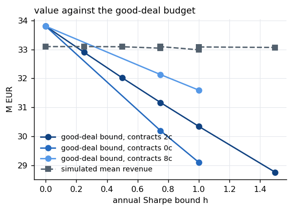
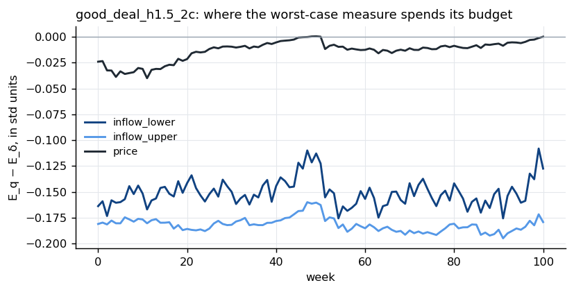
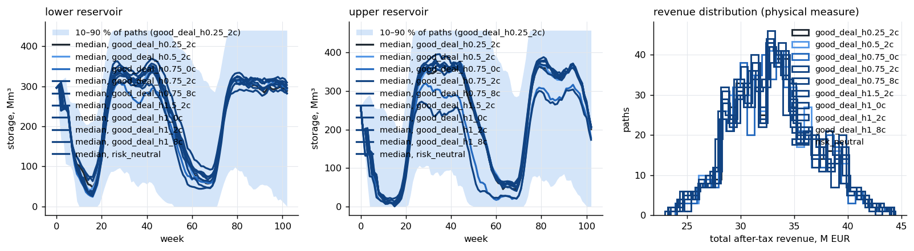
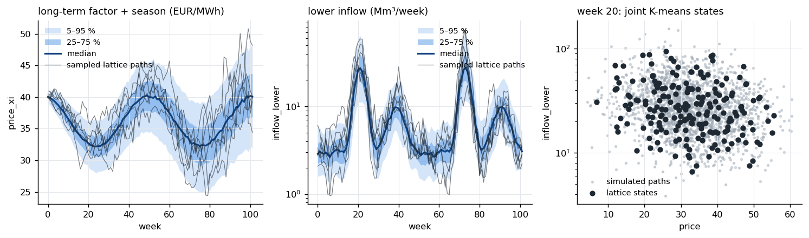

# Good-deal bounds in SDDP for hydropower scheduling

A small, readable reference implementation of the method in

> Berthet, M. and Tveit, S. (2026). *Good-deal bounds in SDDP for medium-term hydropower scheduling.*
> Project thesis, Department of Industrial Economics and Technology Management, NTNU.
> Supervisors: Stein-Erik Fleten and Felipe van de Sande Araujo.

The question the method answers: **what is a hydropower plant worth, and how should it be scheduled, when part of
its risk (inflow) cannot be hedged in the forward market?** A risk-neutral valuation ignores that risk; a good-deal
bound prices it by the most pessimistic probability measure that still prices every traded forward correctly and
does not create "too good deals" (Sharpe ratios above a bound `h`). The bound is computed *inside* stochastic dual
dynamic programming (SDDP), one small convex problem per node of the backward pass, so the risk adjustment reaches
the operating policy through the cuts.

Everything is single-threaded and kept as plain as possible: four notebooks walk from raw data to results, and the
algorithm lives in eight short Python modules with the mathematics in their docstrings.

## Pipeline

| step | notebook | what it produces |
|---|---|---|
| 1 | `notebooks/01_price_data_api.ipynb` | Nord Pool system price from a public API (Energi Data Service), weekly series, seasonal profile, starting level |
| 2 | `notebooks/02_namsen_inflow_analysis.ipynb` | weekly inflow of the two equivalent reservoirs from the station flows, periodic AR(1) fit per reservoir, price–inflow coupling |
| 3 | `notebooks/03_forward_curve_pca.ipynb` | weekly forward curve from the futures panel (block and maximum-smoothness), PCA (scikit-learn), Schwartz–Smith two-factor parameters |
| 4 | `notebooks/04_run_gdsddp.ipynb` | lattice, contracts, SDDP training of risk-neutral and good-deal policies, simulation, figures, saved results |

Notebook 4 reads the parameters that notebooks 1–3 wrote to `data/processed/`; if those files are missing it falls back
to the literature values, so it runs on its own.

## What is implemented

The code covers the whole chain from raw data to a risk-adjusted operating policy. Each component is one module, each
with its mathematics in the docstrings (a full function-by-function reference is in `docs/MODULES.md` / `.pdf`).

**1. Price model** (`models.py`, estimated in notebooks 1 and 3). The weekly system price is additive,
`P_t = xi_t + chi_t + season(w)`, with `xi` a random walk (long-term level, volatility `sigma_xi`), `chi` a weekly
AR(1) with coefficient `phi_chi` and volatility `sigma_chi` (short-term deviation), and a cosine season fitted on the
weekly means. Notebook 1 fetches the hourly system price, fits the season and sets the starting level `xi_0` (mean
deseasonalised price over the last year). Notebook 3 estimates the three dynamic parameters from the forward curve:
a maximum-smoothness curve is built from the daily futures panel, weekly log returns of *fixed delivery weeks* are
formed, a PCA (scikit-learn) checks that two factors explain the variance, and the model covariance
`sigma_xi^2 + sigma_chi^2 phi^(k+j)` is fitted to the empirical one by weighted least squares.

**2. Inflow model** (`models.py`, estimated in notebook 2). Station flows are aggregated to the two equivalent
reservoirs (upper: Namsvatn, Vekteren, Limingen; lower: Tunnsjø, Tunnsjøflyene) and to weekly volumes. Each
reservoir follows a periodic AR(1) on the log inflow with one `(mu, phi, sigma)` per week of the year; the two
innovations are correlated week by week, and both are correlated with the price innovation (`rho_price_inflow`,
negative: wet weeks come with low prices). This is the risk the forward market cannot hedge.

**3. Lattice** (`lattice.py`). The two models are simulated jointly (30 000 paths in the full run) and quantised
week by week with one joint K-means over the standardised coordinates `(chi, xi + season, log I_upper, log I_lower)`
into `K` states; transition probabilities are the empirical frequencies between consecutive weeks. The result is a
first-order Markov chain the scheduling problem is solved on.

**4. Forward contracts on the lattice** (`contracts.py`). A contract delivers one MWh per week over a delivery
window and settles on the weekly price. Its fair value in every node, `F_j(t, m)`, is computed by backward recursion
under the physical probabilities, and the increments `dF_j` to the successors have zero mean (martingale check
`~1e-15`). The sets used in the experiments: `2c` = H2 (weeks 27–52) + Y2 (53–102), `8c` = eight monthly, quarterly
and yearly contracts, `0c` = none.

**5. Node problem** (`hydro.py`). One Gurobi LP per node: two reservoirs in cascade (release, spill, end storage of
each; the upper plant discharges into the lower reservoir), after-tax revenue from the weekly price plus the
discounted continuation value, one variable `alpha_m'` per successor bounded by the successor's cuts. The duals of
the two water balances are the water values that form the next cut. A terminal water value credits the water left
at the end of the horizon with the expected end-of-horizon after-tax price.

**6. Good-deal step** (`gooddeal.py`). In the backward pass the continuation values of the successors are averaged
not with the physical probabilities `delta` but with the worst measure in the good-deal set, the solution of a small
convex QCQP (Gurobi):

```
min_q  sum_m' q(m') V(m')
s.t.   sum q = 1,  q >= 0
       sum_m' q(m') dF_j(m') = 0                 for every live contract j    (forwards stay fairly priced)
       sum_m' q(m')^2 / delta(m') <= 1 + h^2/52  (no Sharpe ratio above h per year)
```

The martingale rows remove every direction the forwards span, so the budget `h` is spent on the risk the contracts
cannot reach, mainly inflow. `h = 0` returns `delta` and gives the risk-neutral policy.

**7. SDDP** (`sddp.py`). Cuts are seeded by three backward sweeps at 10, 50 and 90 % of capacity; each iteration
then runs one forward pass along a sampled lattice path and one backward pass over every state of every week with
`q*` (or `delta`) as weights. The first-stage objective is a bound that decreases with the iterations; training stops
at a maximum iteration count or when the bound moves less than a tolerance over a window. The measure `q*` of the
last pass is stored, so the distortion can be inspected afterwards.

**8. Simulation and reporting** (`simulate.py`, `plots.py`, `experiment.py`). Every policy is simulated on fresh
paths under the physical measure (bound, revenue distribution, storage trajectories), and the figures below are
produced by `report`.

## Results of the full-size run

102 weeks, 200 states per week, 30 000 lattice paths, 50 SDDP iterations, 500 simulated paths; parameters from the
real system price (notebook 1), the sample inflow (notebook 2) and the sample futures panel (notebook 3). The run
took 1–2 hours per policy on one core and about 50 GB of memory (see below).

| policy | contracts | bound, M EUR | premium vs risk neutral | simulated mean | CVaR 5 % | end storage lower, Mm³ |
|---|---|---|---|---|---|---|
| risk neutral | – | 33.80 | – | 33.10 | 25.75 | 255 |
| good deal h = 0.25 | 2c | 32.90 | 0.90 | 33.10 | 25.73 | 257 |
| good deal h = 0.5 | 2c | 32.02 | 1.78 | 33.09 | 25.73 | 260 |
| good deal h = 0.75 | 2c | 31.17 | 2.63 | 33.09 | 25.68 | 260 |
| good deal h = 1.0 | 2c | 30.35 | 3.45 | 33.08 | 25.65 | 264 |
| good deal h = 1.5 | 2c | 28.77 | 5.03 | 33.07 | 25.60 | 267 |
| good deal h = 0.75 | none | 30.20 | 3.60 | 33.04 | 26.02 | 258 |
| good deal h = 0.75 | 8c | 32.13 | 1.66 | 33.10 | 25.69 | 261 |
| good deal h = 1.0 | none | 29.11 | 4.69 | 32.99 | 26.11 | 256 |
| good deal h = 1.0 | 8c | 31.60 | 2.20 | 33.08 | 25.66 | 262 |

What the numbers say:

* **The good-deal bound is the value of the plant net of a price for its unhedgeable risk.** The premium is close
  to linear in `h` (about 3.4 M EUR per unit of `h` with two contracts) while the simulated mean revenue is the same
  for every policy: the risk adjustment is a valuation, not a different dispatch.
* **Contracts reduce the premium.** At `h = 0.75` it is 3.60 M without contracts, 2.63 M with two and 1.66 M with
  eight. The martingale rows remove the hedgeable part of the risk from the budget.
* **The budget goes to inflow.** With contracts live the worst-case measure tilts inflow by −0.15 to −0.19 standard
  deviations in every week and leaves the price almost untouched; the good-deal policies keep more water in store.
  Without contracts the measure tilts the price instead, and the policy becomes more defensive (lower spread, higher
  CVaR).
* **A finer lattice does not change the premium.** With 300 states the risk-neutral bound is 0.6 % lower and the
  premium at `h = 0.75` is 2.67 M instead of 2.63 M.

| | |
|---|---|
|  |  |
| bound against the budget, one line per contract set | where the worst-case measure spends its budget (h = 1.5, 2c) |





## Install and run

```bash
pip install -r requirements.txt          # numpy, pandas, scipy, scikit-learn, matplotlib, gurobipy, requests, jupyter
python3 scripts/make_sample_data.py      # (already shipped) regenerates the synthetic sample data
python3 tests/test_smoke.py              # ~1 minute end-to-end check
jupyter lab notebooks/                   # run 01 -> 02 -> 03 -> 04
```

Gurobi is used for the node LP and the good-deal QCQP; a free academic licence works (the problems are tiny). Python
3.10 or newer.

The notebooks are shipped with their outputs. Notebook 1 ran on the real (public) system price; notebooks 2 and 3 ran
on the **synthetic sample** in `data/sample/`, where notebook 3 is a parameter-recovery test: the panel was generated
with `phi_chi = 0.977, sigma_chi = 2.3, sigma_xi = 0.55` and the PCA fit returns `0.974, 2.62, 0.51` (smooth curve;
`2.57` with the block curve). Notebook 4 holds the outputs of the full-size run of the results section, so its
parameter cell is set to 102 weeks and 200 states (several hours and ~50 GB): for a laptop set `T = 52`, `K = 50`,
`N_LATTICE_PATHS = 5000` and `N_SIM_PATHS = 300` (about 30 minutes). To run on real data, drop the files described in
`data/README.md` into `data/raw/` (git-ignored) and re-run the notebooks.

## Larger runs: the command line and a cluster

Notebook 4 is comfortable up to about 50 states and 52 weeks on a laptop. For the full-size case (102 weeks, 200
states) every node LP is kept in memory with one cut row per successor, so a policy grows to about 50 GB over 50
iterations (75 GB at 300 states) and takes 1–2 hours on one core. `scripts/run_experiment.py` therefore splits the
run into independent steps that can run as separate jobs, one per machine or node:

```bash
python3 scripts/run_experiment.py build  --name full --T 102 --K 200 --paths 30000          # lattice, once
python3 scripts/run_experiment.py train  --name full --h 0                                  # risk neutral
python3 scripts/run_experiment.py train  --name full --h 0.5 --contracts H2:27-52+Y2:53-102 --tag 2c   # one job per policy
python3 scripts/run_experiment.py report --name full                                        # table + figures
```

`cluster/` holds the SGE wrappers used for the results above (NTNU's Solstorm cluster; adapt the module lines for
another scheduler): `job.sh` runs one step, `job_notebook.sh` executes notebook 4 in place with parameters from a
file (`scripts/set_notebook_params.py`), `submit_full.sh` submits a build plus one job per `h`, and
`submit_overnight.sh` submits the whole experiment of the results section, chained so that one job runs per node
at a time. Results are pulled back and `report` is run locally.

## Layout

```
gdsddp/            the algorithm (models, lattice, contracts, hydro, gooddeal, sddp, simulate, plots, data, forwardcurve, experiment)
notebooks/         01 price API · 02 inflow analysis · 03 forward-curve PCA · 04 run everything
scripts/           make_sample_data.py · run_experiment.py (build / train / report) · set_notebook_params.py
cluster/           job.sh · job_notebook.sh · submit_full.sh · submit_overnight.sh (SGE)
docs/              MODULES.md / MODULES.pdf (module reference) · figures/ (the figures shown above)
data/sample/       synthetic inputs (committed)      data/raw/   real inputs (git-ignored)
data/processed/    parameters written by notebooks 1–3 (git-ignored)
results/           outputs of notebook 4 and run_experiment.py (git-ignored)
tests/             smoke test
```

## What is simplified relative to the thesis

* One price factor pair and one plant; the thesis also sweeps `h`, contract sets and lattice resolutions and studies
  hedging overlays. Those are experiments, not algorithm changes, and can be scripted from notebook 4.
* No cut pruning and no parallel backward pass: a backward pass is one Python loop over `T x K` nodes.
* The good-deal step is solved as a QCQP by Gurobi at every node (the thesis derives a closed-form KKT solution; the
  QCQP is the transparent version and gives the same `q*`).
* The lattice uses one joint K-means over all coordinates; the thesis' base case clustered price and inflow separately.

## References

* Cochrane, J. H. and Saá-Requejo, J. (2000). Beyond arbitrage: good-deal asset price bounds in incomplete markets. *JPE* 108.
* Schwartz, E. and Smith, J. E. (2000). Short-term variations and long-term dynamics in commodity prices. *Management Science* 46.
* Pereira, M. V. F. and Pinto, L. M. V. G. (1991). Multi-stage stochastic optimization applied to energy planning. *Math. Programming* 52.
* Koekebakker, S. and Ollmar, F. (2005). Forward curve dynamics in the Nordic electricity market. *Managerial Finance* 31.
* Kleiven, A., Risanger, S. and Fleten, S.-E. (2023). Co-movements between forward prices and resource availability in hydro-dominated electricity markets. *Energy Systems*.
